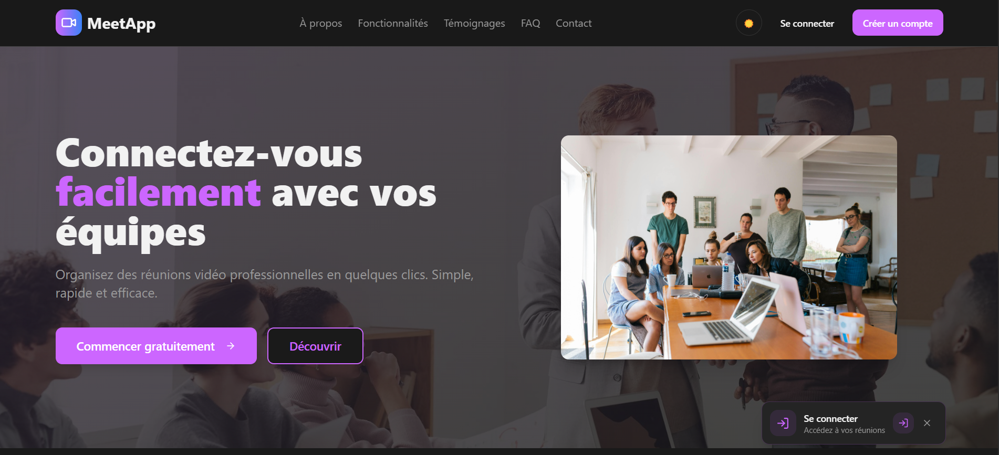

# MeetFlow

**MeetFlow** (présenté sous le nom **MeetApp** dans l’interface) est une application web de communication pour organiser des réunions, gérer ses contacts et échanger par message.


## Aperçu



## Fonctionnalités

- **Comptes et profils** : inscription par email/mot de passe ou Google, préférences de profil et de présence.
- **Contacts** : gestion des contacts, disponibilité et démarrage d’une discussion ou d’un appel.
- **Messagerie** : conversations directes et de groupe, mises à jour en temps réel et historique des messages.
- **Réunions** : création et gestion des invitations, suivi des réunions et accès par lien.
- **Salles audio/vidéo** : appels WebRTC, commandes caméra et micro, partage d’écran, rôles et modération.
- **Interface adaptable** : navigation et conversations conçues pour les écrans mobiles et de bureau.

## Architecture

| Partie | Technologies et responsabilités |
| --- | --- |
| Interface | React 18, TypeScript, Vite, Tailwind CSS et composants Radix UI |
| Authentification et données | Firebase Authentication et Cloud Firestore |
| Appels | WebRTC natif en maillage entre navigateurs ; Firestore sert à la présence et à la signalisation (offres SDP, réponses et candidats ICE) |
| API facultative | Express, Firebase Admin et Nodemailer pour certaines opérations de compte et l’envoi d’emails |

Les médias audio/vidéo sont échangés entre les navigateurs : le serveur Express ne les relaie pas. La configuration actuelle utilise des serveurs STUN publics, sans service TURN inclus. Selon le réseau ou le pare-feu, un serveur TURN peut être nécessaire pour établir certains appels.

## Démarrage local

### Prérequis

- Node.js et npm
- Un projet Firebase avec Authentication et Cloud Firestore configurés

### 1. Installer les dépendances

```bash
npm install
```

### 2. Configurer Firebase

Copiez `.env.example` vers `.env`, puis renseignez les valeurs de configuration Firebase :

```env
VITE_FIREBASE_API_KEY=
VITE_FIREBASE_AUTH_DOMAIN=
VITE_FIREBASE_PROJECT_ID=
VITE_FIREBASE_STORAGE_BUCKET=
VITE_FIREBASE_MESSAGING_SENDER_ID=
VITE_FIREBASE_APP_ID=
```

`VITE_FIREBASE_DATABASE_URL` est également présent dans l’exemple d’environnement, mais l’application utilise Cloud Firestore.

Dans Firebase Authentication, activez les fournisseurs **Email/Mot de passe** et **Google**. Activez aussi **Anonyme** si vous souhaitez autoriser l’accès invité aux salles.

Configurez les règles et les index Firestore du dépôt (`firestore.rules` et `firestore.indexes.json`) pour le projet Firebase utilisé. Avant tout déploiement, vérifiez les permissions avec les parcours et les comptes de votre application.

### 3. Lancer l’interface

```bash
npm run dev
```

Vite affiche l’adresse locale, généralement `http://localhost:5173`.

### API facultative

Pour les fonctions qui utilisent le serveur Express, configurez `VITE_API_BASE_URL` dans `.env` (par exemple `http://localhost:4000`) et lancez dans un autre terminal :

```bash
npm run start:server
```

Le serveur peut nécessiter un compte de service Firebase Admin (`FIREBASE_SERVICE_ACCOUNT_JSON` ou `FIREBASE_SERVICE_ACCOUNT_PATH`). Les identifiants SMTP (`MAIL_HOST`, `MAIL_USERNAME`, `MAIL_PASSWORD` et variables associées) sont nécessaires uniquement pour l’envoi d’emails.

> Ne publiez jamais de compte de service, de mot de passe SMTP ou de fichier `.env`. Les variables préfixées par `VITE_` sont intégrées au client : elles ne doivent pas contenir de secrets. La sécurité des données repose notamment sur les règles Firebase.

## Commandes utiles

| Commande | Description |
| --- | --- |
| `npm run dev` | Démarre le serveur de développement Vite |
| `npm run build` | Génère la version de production dans `dist/` |
| `npm run build:dev` | Génère le build en mode développement |
| `npm run preview` | Prévisualise le build localement |
| `npm run lint` | Lance ESLint |
| `npm run start:server` | Démarre l’API Express facultative |
| `npm run migrate:contacts` | Lance le script de migration des contacts |

## Notes sur les appels

- La salle utilise une connexion WebRTC en maillage et limite à six le nombre de participants dans le parcours actuel.
- Les autorisations caméra et microphone doivent être accordées au navigateur. Les médias nécessitent un contexte sécurisé : HTTPS ou `localhost`.
- Le fonctionnement dépend aussi des appareils disponibles et des règles réseau ; STUN seul ne garantit pas la connexion sur tous les réseaux.

